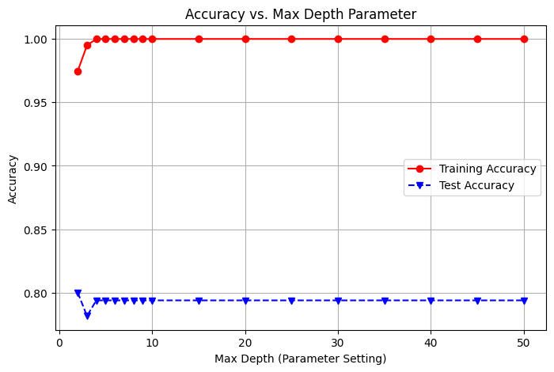
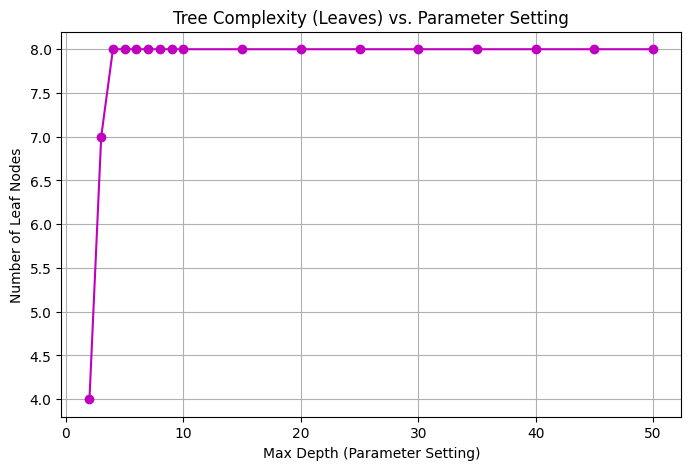
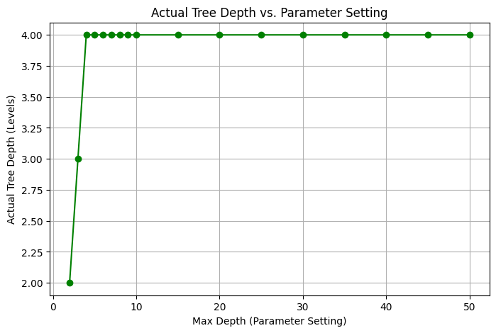
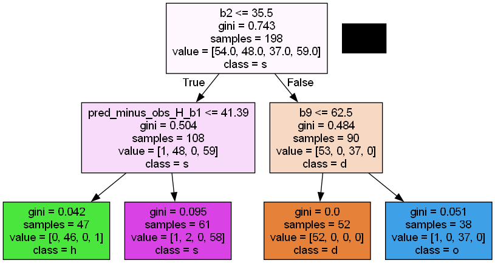
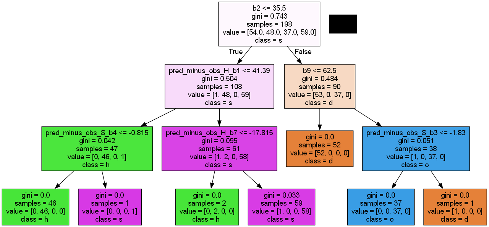
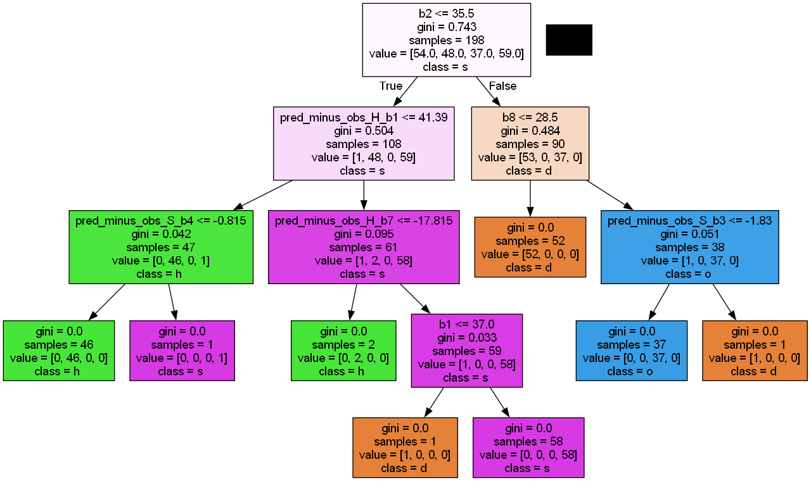

# Introduction and Dataset Overview

The objective of this assignment is to experiment with different decision tree models created via variable parameters and datasets and compare their performances for the classification task, while also analyzing relations between different classes, and identifying areas of error.

This analysis uses the Forest Type Mapping dataset from the UCI Machine Learning Repository. The task is a multi-class classification problem consisting of 4 distinct classes:
* Sugi (s)
* Hinoki (h)
* Mixed deciduous (d)
* Non-forest land (o)

The dataset contains 27 input attributes:
* Attributes 1–9 represent remote sensing measurements from multiple spectral bands.
* Attributes 10–27 represent interpolated spectral information.

# Task A: Decision tree construction and comparison  

## Selecting Models

For each depth value in [2,3,4,5,6,7,8,9,10,15,20,25,30,35,40,45,50] we calculate the accuracy and plot the results. 
Note: Depth value of 1 not chosen as that will only result in 2 classifications, whereas we have 4 classes. 

```
clf = tree.DecisionTreeClassifier(max_depth=depth, random_state=67)
clf = clf.fit(X_train, Y_train)
Y_predTrain = clf.predict(X_train)
Y_predTest = clf.predict(X_test)
trainAcc[index] = accuracy_score(Y_train, Y_predTrain)
testAcc[index] = accuracy_score(Y_test, Y_predTest)
```

Notice that I set random_state so that there is no randomness in tie-breaking. When sklearn builds a decision tree, if two features are equally good at splitting the data, it picks one randomly. If we don't set a "random seed", every time a new DecisionTreeClassifier is created for a depth value, it rolls the dice slightly differently. Therefore what we end up seeing is the difference between lucky and unlucky random splits, not the difference between depths, which is something we don't want. 

We get the following charts: 







As we can see, from max-depth 4 and onwards, the number of levels and leaves are constant at 4 and 8 respectively, meaning that the tree generation maxes out at depth 4 and no distinct models are produced. Therefore it seems prudent to choose max-depth values of 2, 3, and 4 as our points of comparision. 

## Testing Models


### MODEL 1: MAX-DEPTH=2



#### **Overall Classification Accuracy**: 0.8000
#### **Complexity**: 4 nodes 2 levels

#### **Confusion Matrix:**

```
[[ 74   0  11  20]
 [  0  26   0  12]
 [ 10   0  34   2]
 [  5   5   0 126]]
```
---

### MODEL 2: MAX-DEPTH=3



#### **Overall Classification Accuracy**: 0.7815
#### **Complexity**: 7 nodes 3 levels

#### **Confusion Matrix:**
```
[[ 74   0  11  20]
 [  0  29   0   9]
 [ 12   1  32   1]
 [  5  12   0 119]]
 ```
---

### MODEL 3: MAX-DEPTH=4



#### **Overall Classification Accuracy**: 0.7938
#### **Complexity**: 8 nodes 4 levels

#### **Confusion Matrix:**

```
[[ 76   0  15  14]
 [  1  29   0   8]
 [ 10   1  35   0]
 [  6  12   0 118]]
 ```
---
## Comparing Models

Based on the generation of the three distinct decision tree models, we can draw the following comparisons regarding their structural complexity, predictive performance, and the underlying trade-offs.

### 1. Model Complexity

The degree of complexity of the model grows as the `max_depth` is set to greater values; while this trend will continue through level 4, stop at this point for this data set. 
* **Model 1 (Depth 2)** has the minimum level of complexity available; it has only 2 levels and 4 potential outcome characteristics.
* **Model 2 (Depth 3)** has approximately double the degree of complexity of Model 1 (depth 2), having 7 nodes (3 more than model 1) and 3 levels.
* **Model 3 (Depth 4)** represents the maximum potential complexity for the features in this particular data set. It is limited to 8 leaf nodes and there are no additional levels allowed.

### 2. Classification Performance

The test set's predictive performance does not improve as complex rules are learned in nonintuitive ways.
* **Model 1** achieved the highest classification accuracy of approximately 80%, and attained the best performance when compared to an unseen test set.
* **Model 2** achieved approximately 78.15% classification accuracy; the introduction of the 3 additional leaf nodes resulted in several misclassifications that were not previously found with the model at level 2.
* **Model 3** achieved an classification accuracy of approximately 79.38%, however the additional levels and nodes in model 3 did not provide any improvement in predictive performance above the classifier accuracy achieved in the simpler classifiers (i.e., level 1 classifier, model 1).

### 3. Observed Trade-offs Between Simplicity and Accuracy

It can be concluded that a simpler model tends to be the most accurate, based on the relationship between simplicity and accuracy. Adding complexity to Models 2 and 3 may have resulted in increased noise levels in those models. As a result, Model 1 has the least amount of computation (due to reduced complexity) and produced the best accuracy on the test dataset.

---

# Task B: Effect of training/test set exchange  

## Selecting Models

For consistency and direct comparision with task A, I have kept the parameter values constant across both tasks, hence the only difference between the models in Task A and models in Task B is the training set and that is it. 

## Testing Models

## SWAPPED MODEL 1: MAX-DEPTH=2


### **Overall Classification Accuracy**: 0.8939
### **Complexity**: 4 nodes 2 levels

### **Confusion Matrix:**

```
[[52  0  1  1]
 [ 1 35  0 12]
 [ 3  0 34  0]
 [ 1  2  0 56]]

```
---

## SWAPPED MODEL 2: MAX-DEPTH=3


### **Overall Classification Accuracy**: 0.8737
### **Complexity**: 8 nodes 3 levels

### **Confusion Matrix:**

```
[[53  0  1  0]
 [ 4 32  0 12]
 [ 4  0 33  0]
 [ 2  2  0 55]]
 ```
---

## SWAPPED MODEL 3: MAX-DEPTH=4


### **Overall Classification Accuracy**: 0.8687
### **Complexity**: 14 nodes 4 levels

### **Confusion Matrix:**

```
[[52  0  1  1]
 [ 2 34  0 12]
 [ 6  0 31  0]
 [ 2  2  0 55]]
 ```
---

## Comparing Models (Task B: Swapped Dataset)

By exchanging the roles of the training and testing datasets, we observe significant shifts in both model structure and predictive behavior.

### 1. Changes in Model Complexity
After switching the two data sets, one of the very first things I noticed was the much larger number of levels in the decision tree structure created for Task B compared to Task A.  
* Task A had a maximum of **4 levels and 8 leaf nodes** the decision tree. 
* Task B had a much larger decision tree structure than the one used for Task A with my models having **14 nodes** compared to Task A's 8 nodes, for the same number of levels (4). 

What this shows is that the test set data used for Task B had many more complex, overlapping and/or noisy patterns that require deeper splits to separate.

### 2. Changes in Model Performance
Though the tree-depth increase was quite significant, the performance for both cases of classifying remained true to the Task A definition: simple is better!
* **Model 1 (Depth 2)** again produced the highest performing overall classifying model at a classification accuracy of an impressive ~89.39%. The constraints of having a limited rule set allowed for the creation of stronger predictions based upon previously unseen data.
* **Model 2 (Depth 3)** exhibited reduced performance with a fall-off to an approximation of an 87.37% classification accuracy. The increased complexity incorporated within this model caused it to lose track of general rules and produce more misclassifications.
* **Model 3 (Depth 4)** was also highly overfit relative to Model 1 and even relative to Model 2, as the additional leaf nodes added to the tree structure decreased performance further slightly to approximately 86.87% classification accuracy — and provided no incremental predictive ability based upon previously unseen data as compared to Model 1 and 2.

### 3. Discussion: Dataset Similarity and Generalization Ability
The outcomes from before/after the swap give us useful information on both the datasets and on decision-tree characteristics:

1. **Similarity of Datasets:** The asymmetric nature of the datasets is clear. The prior training data was fairly straightforward and "clean"; the tree had no problem quickly locating the best possible splits of the data. In contrast, the original testing data (currently the Task B training data) was considerably more difficult to classify; as a result, the tree was forced to build a large (14-node) tree to classify the training data. Thus, it appears that the original split of the training and test data was poorly stratified and/or one of the two sub-datasets contained a significantly larger proportion of outlier noise than the other sub-dataset.
2. **Generalization Capacity:** Of the many conclusions drawn from the results of both tasks, the most important was that the generalization ability of both models is limited by the way the models grew. Whether the model was trained with the "easy" dataset or the "hard" dataset, the most representative generalizations were produced when the tree was limited in size (max depth = 2). 

These results suggest that the underlying true signal present in this data is relatively simple, and as a tree grows deeper in size, it becomes increasingly less likely to retain the "true signal" and instead becomes more likely to memorize the "noise" from its own training set. Therefore, the use of a constrained decision tree is likely to yield the most thorough and accurate generalization of the specific classification problem presented in the datasets examined.

---

# Task C: Class-wise performance and confusion matrix analysis  

For the analysis, we will analyse two models that show Max Depth 2 from two different dataset distributions, One using the Original Dataset and the Other using the Swapped. The two Models have been chosen because they are the performing Generalized Models for Both Dataset Configurations. This allows us to see how the dataset swap has affected individual class predictions for each model.

*(Note: Based on the dataset, the confusion matrix rows/columns correspond to the classes `['d', 'h', 'o', 's']` in that order).*

## 1. Class-Wise Classification Accuracy

By analyzing the diagonal and row totals of the confusion matrices, we can calculate the classification accuracy for each individual class. 

**Task A - Model 1 (Depth 2):**
* **Class 'd':** 74 correct out of 105 total instances = **70.48% accuracy**
* **Class 'h':** 26 correct out of 38 total instances = **68.42% accuracy**
* **Class 'o':** 34 correct out of 46 total instances = **73.91% accuracy**
* **Class 's':** 126 correct out of 136 total instances = **92.65% accuracy**
```
[[ 74   0  11  20]
 [  0  26   0  12]
 [ 10   0  34   2]
 [  5   5   0 126]]
 ```

**Task B - Swapped Model 1 (Depth 2):**
* **Class 'd':** 52 correct out of 54 total instances = **96.30% accuracy**
* **Class 'h':** 35 correct out of 48 total instances = **72.92% accuracy**
* **Class 'o':** 34 correct out of 37 total instances = **91.89% accuracy**
* **Class 's':** 56 correct out of 59 total instances = **94.92% accuracy**
```
[[52  0  1  1]
 [ 1 35  0 12]
 [ 3  0 34  0]
 [ 1  2  0 56]]
 ```

**Observation:** The tree is very good at identifying class 's"'across the two splits, with over 92% accuracy in both cases. A big improvement occurred in Task B for both classes 'd' and "o". This also demonstrates the asymmetry of the two subsets of data discussed in Task B.

## 2. Frequently Confused Class Pairs

The off-diagonal entries in the matrices show that two classes had a lot of confusion in the decision tree classification.

### Pair 1: Class 'h' and Class 's'
This pair consistently showed confusion in both models.
* **Task A (Model 1):** 
    * The 'h' class was misclassified as 's' in 12/38 (31.58%) cases
    * The 's' class was misclassified as 'h' in 5/136 (3.68%) cases.
* **Task B (Swapped Model 1):** 
    * The 'h' class was misclassified as 's' in 12/48 (25.00%) cases
    * The 's' class was misclassified as 'h' in 2/59 (3.39%) cases.

**Comment:** The percentage rates of confusion for the two classes are very similar in the two models. The confusion is mostly one-sided, with the model misclassifying the 'h' class as 's' (about 25-31% of the time) and rarely misclassifying the 's' class as 'h' (about 3% of the time). This suggests there is some overlap between the two classes regardless of the method used to stratify the training/test data.

### Pair #2: Class 'd' versus Class 's' 

The model confusion in Task A is quite high, and there is virtually no model confusion in Task B. 
* **Task A (Model 1):** 
    * The'd' class was misclassified as 's': 20/105 (19.05%)
    * The 's' class was misclassified as 'd': 5/136 (3.68%)
* **Task B (Swapped Model 1):** 
    * The'd' class was misclassified as 's': 1/54 (1.85%)
    * The 's' class was misclassified as 'd': 1/59 (1.69%)

**Comment:** There is a dramatic change in misclassification rates for this pair from Task A to Task B. In Task A, there were 20% of 'd' samples incorrectly classified as 's.' In Task B, the misclassification rate was less than 2%. This indicates that there is *not* an inherent characteristic for misclassification between classes 'd' and 's.' The original test set used in Task A included a very specific subset of possibly noisy samples from class 'd' that were difficult to distinguish. After these difficult samples were moved to the training set for Task B, the classifier was able to easily understand the difference between classes 'd' and 's.'

---

# Task D: Error case analysis

To determine how our model performs, we checked the test set, using **Task A, Model 1 (depth of 2)**, only looking at misclassifications of the two most plain pairs of confusion from Task (C), which were 'h' predicted to be s and 'd' predicted as s.

According to the decision tree structure, for the _Model 1_, we used to create the two classes the following pair of thresholds separations.

1. The first threshold is the root node split at 'h'/'s' and 'd'/'o' `b2 <= 35.5`
2. The second threshold is the left-hand branch split at which separates h, s `pred_minus_obs_H_b1 <= 41.39`

## Error Case 1: True Class 'h' predicted as 's' (12 instances)

**Attribute Comparison (`pred_minus_obs_H_b1`):** 
* **'h' Instances that are correct** have a low average `pred_minus_obs_H_b1` of **33.88**.
* **'s' Instances that are correct** have a high average `pred_minus_obs_H_b1` of **59.22**. 
* **Misclassified 'h' Instances** have an average `pred_minus_obs_H_b1` of **49.56**. 

**Rule Analysis:** For the model to classify a left tree branch as 's', the instance must pass through the root node (`b2 <= 35.5`) without passing through the second node (`pred_minus_obs_H_b1 <= 41.39`). All the instances being routed to the left branch have `b2` values that are close together (approximately ~27-28), which confirms their correct routing to the left branch. However, the correctly classified instances of 'h' have been classified safely under the threshold of 41.39 (averaging 33.88) while the 12 instances of misclassified 'h' have average `pred_minus_obs_H_b1` values considerably higher than 41.39 (averaging 49.56). Since the decision tree uses rigid hard cutoffs, the presence of a single attribute value exceeding the threshold caused the model to classify the 12 instances as belonging to 's' when they fundamentally belong to class 'h'.

## Error Case 2: True Class 'd' predicted as 's' (20 instances)
**Attribute Comparison (`b2` and `pred_minus_obs_H_b1`):**
* **'d' Instances that are correct** in general have a high average 'b2' value of **45.41**.
* **'s' Instances that are correct** in general have a low average 'b2' value of **28.43**.
* **Misclassified 'd' Instances** in contrast have an abnormally low average 'b2' value of **31.45** and an unusually high value of 'pred_minus_obs_H_b1' **71.22**.

**Rule Analysis:**
This error is a greater severity than other errors since it occurs at the first split in the tree (i.e., root node). For a 'd' instance to be correctly classified, the value for 'b2' must be greater than 35.5, thereby sending it down the right side of the tree. As previously indicated, the true 'd' instances had 'b2' averages of 45.41, thereby easily passing this cutoff. In contrast, these 20 misclassified 'd' instances had a value of 31.45 for the 'b2' attribute (thereby routing them to the incorrect branch) and had no leaf nodes below that were capable of assigning the misclassified instance to class 'd' (therefore, they fell to the default leaf node of class 's' as a result of the significantly large value (71.22) for the attribute pred_minus_obs_H_b1).


## Error Cases Discussion 

### Limitations of the Decision Tree Model
The examples of incorrect classification in the previous section reveal a critical limitation of shallow decision trees: A decision tree is unable to evaluate multiple feature criteria at once or apply weightings when determining appropriate classifications. Instead, the tree's construction relies on single feature values to draw very rigid and non-overlapping step-like boundaries for classification. As a result, if an observation is identified as an outlier based on just *one* feature value (e.g., cases 'd' with the lowest b2 values), that observation will be assigned to the completely wrong subset of decision tree branches. Once an observation enters a particular branch, the decision tree model has lost all ability to recover from the classification and cannot look at any other variables that may imply more accurately to what the true class of the observation would have been.

### Challenges of Distinguishing Confused Classes
The data set has a significant classification challenge because of the **overlapping area between classes**. Error Case 1 shows the boundaries between classes ‘h’ and ‘s’ are blurred. Both class 'h' and 's' show high values for `pred_minus_obs_H_b1` (49.5 avg and 59.2 avg respectively), leading to a grey area. Due to the relatively low ‘max_depth=2’ of the decision tree, there are a limited number of variables that can be combined together to generate classifications/results from the decision tree (only two feature values are combined to create just four leaf nodes in this example). Therefore, the limitations of the decision tree will create a forced boundary at 41.39. Hence certain observations that lie within the “gray area” will be misclassified.

---

# Final Discussion and Conclusion

Through systematic analysis across Tasks A through D, several crucial insights about decision tree classifiers and the Forest Type Mapping dataset emerged. 

1) Complexity doesnot equal Accuracy (necessarily). In both task A and task B it was noticed that the model with the lowest depth (`max_depth=2`) and therefore the simplest complexity had the highest accuracy when it came to predictions on unseen data (80.00% and 89.39%, respectively). This showed that allowing the model to grow caused instances of overfitting which led to noise affecting the models judgment and preventing it from learning generalizable thresholds. 

2) Swapping of the two datasets during the Decision Tree creation process showed us the substantial asymmetries in the data distribution. We found that the original test set was much more complex than the original training set, as it caused the number of nodes to jump to 14 from 8 for the same max_depth of 4. We also saw the swap lead to a jump in the highest overall classification accuracy 80.00% to 89.39% and a drop in the confusion rates between class 'd' and 's' that was prevalent in the original split. 

3) Through the error case analysis, we understood the limitations of decision trees and their splitting methodology. We saw  misclassifications would occur purely due to single outlier attributes causing the decision to be permanently routed away from the correct classification early on in the tree. 

Ultimately, this assignment highlighted the importance of balancing simplicity and accuracy, demonstrating that a well-constrained model can effectively navigate overlapping feature spaces while resisting the pitfalls of overfitting.

[^1]: 
